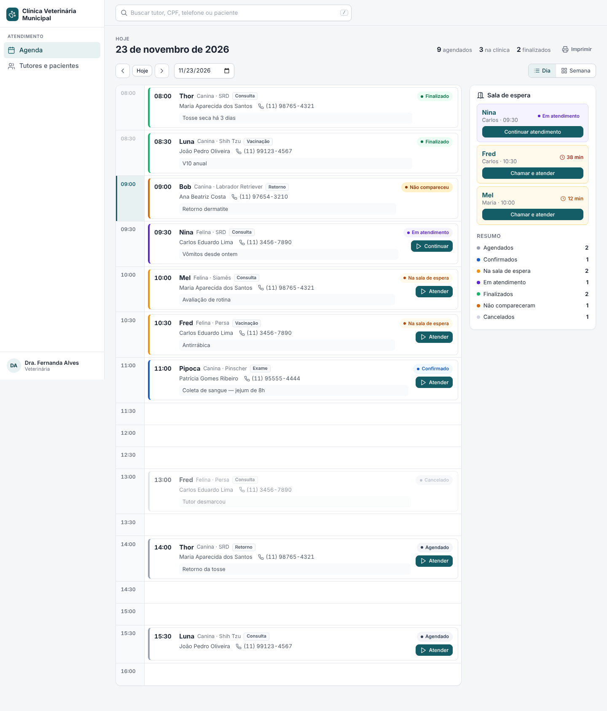

# AMBPET — Sistema da Clínica Veterinária

Sistema web para a **Recepção** e a **Veterinária**: cadastro de tutores e pacientes, agenda com sala de espera, prontuário eletrônico (SOAP) e receituário. O módulo Castramóvel fica de fora; ele roda em um sistema separado.

- Banco de dados: **Supabase (PostgreSQL)**, em schema privado e com papel de menor privilégio.
- Criptografia **AES-256-GCM** dos dados pessoais e clínicos antes de gravar no banco.
- Requisitos da **LGPD**: aviso de privacidade, registro de acessos, exportação e eliminação de dados do titular.
- Nenhum segredo fica no código: tudo vem de variáveis de ambiente.



## Funcionalidades

| Área | O que faz |
|---|---|
| **Agenda** | Visões de dia (grade de horários) e de semana. Atende de segunda a sexta, das 08:00 às 16:00. Escolha de horário em grade, mostrando os já ocupados. Tipos: consulta, retorno, vacinação, exame e procedimento. |
| **Recepção** | Ciclo do agendamento: *Agendado → Confirmado → Chegou (sala de espera) → Em atendimento → Finalizado*, além de *Não compareceu* e *Cancelado*. |
| **Sala de espera** | Mostra quem chegou e há quanto tempo espera (fica em destaque a partir de 30 min). A veterinária chama direto dali. |
| **Tutores e pacientes** | Cadastro em duas etapas (tutor e depois paciente). O CEP preenche o endereço. Busca por nome, CPF, telefone ou nome do pet. |
| **Prontuário** | Banner do paciente com alerta de alergias. Linha do tempo de atendimentos no formato SOAP, com sinais vitais (peso, temperatura, FC, FR, TPC, mucosas, hidratação). O registro não pode ser editado; só recebe complementos. |
| **Receitas** | Vários medicamentos agrupados por via de uso. Modelo simples ou de controle especial (duas vias, com identificação do comprador). Botão "repetir receita" e histórico de medicações com filtro. |
| **Histórico de peso** | Mostra a variação entre um atendimento e outro. |
| **Administração** | Usuários com senha temporária, redefinição de 2FA e desbloqueio. Auditoria com verificação de integridade. Tela de LGPD para atender os titulares. |

Os fluxos seguem padrões de softwares veterinários do mercado: check-in e sala de espera, banner do paciente, prontuário SOAP e modelos de receita.

## Segurança

### Banco de dados (Supabase)
- As tabelas ficam no schema `ambpet`, que **não é exposto** pela Data API (PostgREST) do Supabase.
- **RLS ativo** em todas as tabelas. Há política apenas para o papel `ambpet_app`. Os papéis `anon`, `authenticated` e `service_role` não têm acesso nem ao schema.
- O papel `ambpet_app` tem **o mínimo de privilégios**:
  - não cria nem apaga tabelas;
  - não executa `UPDATE` ou `DELETE` em prontuário, receitas e auditoria;
  - tem `statement_timeout` configurado.
- **Triggers de imutabilidade** valem até para o dono do banco:
  - atendimentos, complementos, receitas e auditoria não aceitam `UPDATE`, `DELETE` nem `TRUNCATE`;
  - tutores, pacientes e usuários não podem ser apagados (a eliminação é feita por anonimização).
- Restrições `CHECK` garantem que CPF e nome só entrem cifrados.
- **TLS obrigatório**: `sslmode=require` por padrão, ou `verify-full` se você fornecer o certificado CA do Supabase.

### Criptografia na aplicação
- Os campos sensíveis são cifrados com **AES-256-GCM** antes de chegar ao banco. O nome da coluna entra como dado associado, então um valor copiado para outra coluna não decifra.
- Campos cifrados:
  - **Tutor:** nome, CPF, telefone, endereço completo e ano do CadÚnico.
  - **Paciente e prontuário:** alergias, condições crônicas, observações, todo o texto SOAP, complementos, itens e orientações das receitas e observações de agendamento.
  - **Sistema:** detalhes da auditoria, IPs e o segredo do 2FA.
- A busca usa **índices cegos (HMAC-SHA256)** com chave própria. O CPF e o telefone são encontrados pelo valor completo; o nome, pelo início das palavras. O texto em claro nunca vai para o banco.
- **Rotação de chaves**: `ENCRYPTION_KEYS=v1:...,v2:...` e depois `flask rotacionar-chaves --confirmar`.
- Um vazamento do banco ou de um backup expõe apenas texto cifrado.

### Acesso
- **Verificação em duas etapas (TOTP)** obrigatória por padrão, com proteção contra reuso do mesmo código.
- **Senhas**:
  - armazenadas com hash scrypt;
  - política de força mínima;
  - senha temporária gerada pelo sistema, com troca obrigatória no primeiro acesso.
- **Bloqueio** após 5 tentativas erradas, por 15 minutos. A mensagem de erro é a mesma para usuário existente ou não, e o tempo de resposta é constante.
- **Sessão**:
  - expira após 30 minutos de inatividade e após no máximo 10 horas;
  - trocar a senha ou o 2FA encerra as outras sessões abertas.
  - O cookie usa `__Host-`, `Secure`, `HttpOnly` e `SameSite=Strict`.
- **Proteções na resposta HTTP**:
  - **CSRF** em todos os formulários;
  - **CSP** estrita: sem script ou estilo em linha e sem conteúdo de terceiros;
  - HSTS, `X-Frame-Options: DENY` e `Cache-Control: no-store` nas páginas com dados;
  - as buscas usam POST, então CPF e telefone não aparecem em URL, histórico ou logs.
- **Perfis**: a Recepção não vê o conteúdo clínico. Só o administrador acessa auditoria, usuários e LGPD.

### LGPD
- **Aviso de privacidade** (`/privacidade`) configurável. O cadastro registra a versão do aviso e a data em que foi apresentado ao tutor.
- **Registro de operações (art. 37)**: toda criação, edição, visualização de ficha ou prontuário, login e exportação fica registrada.
- **Auditoria à prova de adulteração**: os registros são encadeados por HMAC, e a verificação aponta o primeiro registro alterado.
- **Direitos do titular (art. 18)**:
  - exportação completa em JSON (acesso e portabilidade);
  - **eliminação por anonimização**, que apaga de forma irreversível os dados do tutor e mantém o prontuário do animal sem identificação, pelo prazo de guarda legal.
- **Minimização**: listas mostram o CPF mascarado, e o ViaCEP pode ser desligado (`USAR_VIACEP=0`).
- Cada usuário pode consultar o próprio histórico de acessos.

## Instalação com Supabase

### 1. Criar o banco
1. Crie um projeto no Supabase, de preferência na região São Paulo (`sa-east-1`).
2. No **SQL Editor**, cole e rode `supabase/migrations/20261123000000_ambpet_schema.sql`.
3. Ainda no SQL Editor, defina a senha do papel da aplicação. Gere uma senha forte e não salve esse comando em arquivo:
   ```sql
   alter role ambpet_app with login password 'COLE-AQUI-UMA-SENHA-FORTE';
   ```
4. Em **Project Settings → Database**:
   - ative **Enforce SSL**;
   - em **Network Restrictions**, libere apenas o IP do servidor da aplicação;
   - baixe o **certificado CA** para usar `verify-full`.
5. Em **Project Settings → Data API**, confirme que `ambpet` **não** está em *Exposed schemas*.
6. Ative os **backups** (o PITR é recomendado). Os dados sensíveis já estão cifrados dentro do backup.

### 2. Configurar a aplicação
```bash
python3 -m venv .venv && .venv/bin/pip install -r requirements.txt
```
```bash
python scripts/gerar_env.py --producao
```
O segundo comando gera `SECRET_KEY`, `ENCRYPTION_KEYS` e `BLIND_INDEX_KEY`. Cadastre esses valores como variáveis de ambiente na hospedagem, usando `.env.example` como referência. A `DATABASE_URL` usa o **usuário `ambpet_app`** pelo pooler em modo sessão:
```
postgresql://ambpet_app.<ref-do-projeto>:<senha>@aws-0-sa-east-1.pooler.supabase.com:5432/postgres
```

> **Guarde `ENCRYPTION_KEYS` e `BLIND_INDEX_KEY` em um cofre de senhas.** Sem elas, os dados não podem ser recuperados. Elas não devem ficar no mesmo lugar que o backup do banco.

### 3. Primeiro acesso
```bash
.venv/bin/flask --app wsgi criar-usuario --login admin --nome "Seu Nome" --perfil admin
```
```bash
.venv/bin/gunicorn -w 3 -b 0.0.0.0:8000 wsgi:app
```
Rode a aplicação atrás de um proxy com HTTPS e use `BEHIND_PROXY=1`. No primeiro login, configure o 2FA. Depois crie os usuários da Recepção e da Veterinária em **Administração → Usuários**; para a veterinária, informe o CRMV.

## Desenvolvimento local
```bash
python scripts/gerar_env.py
```
```bash
.venv/bin/flask --app wsgi criar-usuario --login admin --nome "Admin Local" --perfil admin
```
```bash
.venv/bin/flask --app wsgi run --debug
```
O primeiro comando cria um `.env` com SQLite, 2FA desligado e chaves aleatórias. O arquivo não deve ser versionado.

## Comandos úteis
| Comando | Para quê |
|---|---|
| `flask --app wsgi verificar-auditoria` | Confere a integridade da trilha de auditoria |
| `flask --app wsgi gerar-chave` | Gera uma nova chave AES-256 |
| `flask --app wsgi rotacionar-chaves --confirmar` | Recifra tudo com a chave ativa (use a conexão `postgres`) |
| `python scripts/gerar_migracao.py` | Gera o DDL das tabelas a partir dos modelos |

## Testes
```bash
.venv/bin/pip install -r requirements-dev.txt && .venv/bin/python -m pytest
```
Para rodar contra PostgreSQL, defina `TEST_DATABASE_URL=postgresql://...`, apontando para um banco de testes que tenha o schema `ambpet`.
